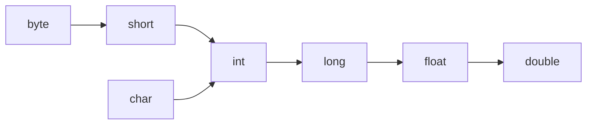

## 1. Introduzione

Java è un linguaggio **fortemente tipizzato**: ogni variabile ha un tipo e il compilatore controlla che i valori assegnati siano compatibili.

Spesso però dobbiamo usare un valore di un tipo dove ne serve un altro: ad esempio mettere un `int` in un `double`, oppure il risultato di una divisione decimale in un `int`. Questa operazione si chiama **casting** (o *conversione di tipo*).

Esistono due tipi di casting:

- **Casting implicito** (*widening*, "allargamento") → lo fa Java **da solo**, perché è sicuro.
- **Casting esplicito** (*narrowing*, "restringimento") → lo deve scrivere **il programmatore**, perché si possono perdere dati.

<Aside variant="info">
**Analogia dei bicchieri**: pensa ai tipi come a contenitori di dimensioni diverse.
Versare l'acqua da un bicchiere piccolo in una caraffa grande (es. `int` → `double`) è sempre sicuro: Java lo fa senza chiederti nulla.
Versare una caraffa in un bicchiere piccolo (es. `double` → `int`) può far traboccare l'acqua: Java ti obbliga a dire esplicitamente "lo so, versa lo stesso".
</Aside>

## 2. I tipi primitivi e le loro dimensioni

Per capire quale conversione è sicura bisogna conoscere quanto spazio occupa ogni tipo primitivo:

| Tipo | Dimensione | Intervallo / esempio |
| --- | --- | --- |
| `byte` | 8 bit | da -128 a 127 |
| `short` | 16 bit | da -32.768 a 32.767 |
| `char` | 16 bit | caratteri Unicode, da 0 a 65.535 |
| `int` | 32 bit | circa ±2,1 miliardi |
| `long` | 64 bit | circa ±9,2 × 10<sup>18</sup> |
| `float` | 32 bit | decimale, circa 7 cifre significative |
| `double` | 64 bit | decimale, circa 15 cifre significative |
| `boolean` | — | solo `true` / `false` |

Il "verso sicuro" delle conversioni è questo:



- Seguire le frecce → **casting implicito** (automatico).
- Andare contro le frecce → **casting esplicito** (obbligatorio scriverlo).

<Aside variant="warning">
`boolean` non si può convertire in nessun altro tipo primitivo, né il contrario: in Java `(int) true` e `(boolean) 1` sono **errori di compilazione** (in C/C++ invece sono permessi).
</Aside>

## 3. Casting implicito (widening)

Avviene **automaticamente** quando si assegna un valore di un tipo "più piccolo" a una variabile di un tipo "più grande".

```java
int numero = 42;
long grande = numero;      // int -> long  (implicito)
double decimale = numero;  // int -> double (implicito)

System.out.println(grande);   // 42
System.out.println(decimale); // 42.0

char lettera = 'A';
int codice = lettera;         // char -> int: il codice Unicode
System.out.println(codice);   // 65
```

Non serve scrivere nulla: il valore "entra" comodamente nel tipo di destinazione.

### 3.1 Promozione nelle espressioni

Il casting implicito avviene anche **dentro le espressioni**: quando un'operazione coinvolge tipi diversi, Java converte il più "piccolo" nel tipo del più "grande" prima di calcolare.

```java
int a = 7;
double b = 2.0;

System.out.println(a + b);  // 9.0  -> a viene promosso a double
System.out.println(a / b);  // 3.5
System.out.println(a / 2);  // 3    -> int / int = divisione INTERA
```

<Aside variant="warning">
**Attenzione alla divisione tra interi!** `7 / 2` vale `3`, non `3.5`, perché entrambi gli operandi sono `int`. Anche scrivendo `double r = 7 / 2;` si ottiene `3.0`: la divisione viene fatta **prima** (tra interi) e solo **dopo** il risultato viene convertito in `double`.
</Aside>

Inoltre, nelle operazioni aritmetiche `byte`, `short` e `char` vengono sempre promossi almeno a `int`:

```java
byte x = 10;
byte y = 20;
byte z = x + y;        // ERRORE: x + y è un int
int  w = x + y;        // OK
byte k = (byte)(x + y); // OK con casting esplicito
```

### 3.2 Implicito non vuol dire sempre "senza perdite"

Le conversioni `int` → `float`, `long` → `float` e `long` → `double` sono implicite, ma con numeri molto grandi possono perdere qualche cifra di **precisione** (non di grandezza):

```java
int n = 16777217;
float f = n;
System.out.println(f); // 1.6777216E7  -> l'ultima cifra è cambiata
```

## 4. Casting esplicito (narrowing)

Quando si vuole convertire un tipo "più grande" in uno "più piccolo", Java **non lo fa da solo** e dà un errore di compilazione:

```java
double prezzo = 9.99;
int euro = prezzo; // ERRORE: incompatible types: possible lossy conversion from double to int
```

Bisogna scrivere il tipo di destinazione **tra parentesi tonde** davanti al valore:

$$
(tipo) \ valore
$$

```java
double prezzo = 9.99;
int euro = (int) prezzo;   // casting esplicito
System.out.println(euro);  // 9
```

Con il casting esplicito il programmatore si **prende la responsabilità** di un'eventuale perdita di dati.

### 4.1 Cosa si può perdere

1. **La parte decimale** (troncamento): da `double`/`float` a un tipo intero la parte dopo la virgola viene **tagliata**, non arrotondata.

    ```java
    System.out.println((int) 3.99);   // 3
    System.out.println((int) -3.99);  // -3
    System.out.println(Math.round(3.99)); // 4  -> per arrotondare si usa Math.round
    ```

2. **Il valore** (overflow): se il numero non entra nel tipo di destinazione, si tengono solo i bit "bassi" e il risultato può sembrare senza senso.

    ```java
    int grande = 300;
    byte piccolo = (byte) grande;
    System.out.println(piccolo); // 44  (300 - 256)

    System.out.println((byte) 130); // -126
    ```

3. **La precisione**: da `double` a `float` si perdono cifre decimali.

    ```java
    double pi = 3.141592653589793;
    float piF = (float) pi;
    System.out.println(piF); // 3.1415927
    ```

### 4.2 Casting per ottenere una divisione decimale

Uno degli usi più comuni del casting esplicito è "forzare" una divisione decimale tra due interi:

```java
int somma = 30;
int quanti = 4;

double sbagliata = somma / quanti;          // 7.0  (divisione intera, poi convertita)
double giusta    = (double) somma / quanti; // 7.5
```

<Aside variant="tip">
Il casting ha **precedenza più alta** della divisione: `(double) somma / quanti` converte prima `somma` e poi divide. Invece `(double) (somma / quanti)` divide prima tra interi e dà `7.0`.
</Aside>

### 4.3 Casting tra `char` e `int`

Ogni carattere corrisponde a un numero (il suo codice Unicode). Si può quindi passare da uno all'altro:

```java
char c = 'A';
int codice = c;                 // implicito: 65
char successivo = (char) (c + 1); // esplicito: 'B'

System.out.println(codice);     // 65
System.out.println(successivo); // B
```

`c + 1` è un `int` (promozione), quindi per rimetterlo in un `char` serve il casting esplicito.

## 5. Casi particolari

### 5.1 Letterali `long` e `float`

Un numero intero scritto nel codice è un `int`, un numero con la virgola è un `double`. Per indicare un altro tipo si usa un suffisso:

```java
long popolazione = 8000000000L;  // senza L: errore, il numero è troppo grande per un int
float temperatura = 21.5f;       // senza f: errore, 21.5 è un double
```

### 5.2 Gli operatori composti fanno un casting nascosto

Gli operatori `+=`, `-=`, `*=`, `/=` includono un casting esplicito automatico:

```java
byte b = 10;
b = b + 5;   // ERRORE: b + 5 è un int
b += 5;      // OK: equivale a b = (byte) (b + 5);
```

### 5.3 Overflow anche senza casting

Il casting implicito avviene **dopo** il calcolo: se il calcolo va in overflow, il danno è già fatto.

```java
int max = 2147483647;          // il più grande int
long risultato = max + 1;      // -2147483648 !! la somma è tra int
long corretto  = (long) max + 1; // 2147483648
```

### 5.4 Le stringhe non si convertono con il casting

Il casting funziona tra tipi **primitivi** compatibili. Per passare da `String` a numero (e viceversa) si usano dei **metodi**:

```java
String testo = "42";
int n = Integer.parseInt(testo);       // String -> int
double d = Double.parseDouble("3.5");  // String -> double

String s = String.valueOf(n);          // int -> String
String s2 = "" + n;                    // altro modo comune

int errore = (int) testo;              // ERRORE di compilazione
```

## 6. E con gli oggetti?

Lo stesso concetto esiste anche tra **classi** legate da ereditarietà:

- **Upcasting** (da sottoclasse a superclasse) → è **implicito**, come il widening.
- **Downcasting** (da superclasse a sottoclasse) → è **esplicito**, come il narrowing, e può fallire a run-time.

```java
Animale a = new Cane();  // upcasting implicito
Cane c = (Cane) a;       // downcasting esplicito
```

Ne parliamo in dettaglio nelle lezioni [Ereditarietà](/informatica/java/7_ereditarieta) e [Upcasting / Downcasting](/informatica/java/8_upcasting-downcasting).

## 7. Riepilogo

| | Casting implicito | Casting esplicito |
| --- | --- | --- |
| Altro nome | widening / promozione | narrowing |
| Direzione | tipo piccolo → tipo grande | tipo grande → tipo piccolo |
| Chi lo fa | il compilatore, in automatico | il programmatore, con `(tipo)` |
| Perdita di dati | no (al più precisione con `float`) | possibile (decimali, overflow) |
| Esempio | `double d = 5;` | `int i = (int) 5.7;` |

## 8. Quiz a risposta multipla

import Quiz from '../../../components/Quiz.jsx';

<Quiz client:load questions={[
  {
    question: "1) Quale di queste assegnazioni è un casting implicito?",
    answers: {
      a: 'int x = 3.5;',
      b: 'double d = 10;',
      c: 'byte b = 300;',
      d: 'int y = (int) 2.7;'
    },
    correctAnswer: 'b',
    explanation: "Da int a double si va verso un tipo più grande: Java converte da solo."
  },
  {
    question: "2) Quanto vale (int) 9.99?",
    answers: { a: '10', b: '9', c: '9.99', d: 'Errore di compilazione' },
    correctAnswer: 'b',
    explanation: "Il casting a int tronca la parte decimale, non arrotonda."
  },
  {
    question: "3) Cosa succede compilando int n = 5.0;?",
    answers: {
      a: 'n vale 5',
      b: 'n vale 0',
      c: 'Errore di compilazione: serve un casting esplicito',
      d: "Errore a run-time"
    },
    correctAnswer: 'c',
    explanation: "5.0 è un double: da double a int si possono perdere dati, quindi serve (int)."
  },
  {
    question: "4) Quanto vale double r = 7 / 2;?",
    answers: { a: '3.5', b: '3.0', c: '4.0', d: 'Errore' },
    correctAnswer: 'b',
    explanation: "7 / 2 è una divisione tra int (= 3); solo dopo il risultato diventa 3.0."
  },
  {
    question: "5) Quale espressione dà 3.5?",
    answers: {
      a: '(double) (7 / 2)',
      b: '(int) 7.0 / 2',
      c: '(double) 7 / 2',
      d: '7 / 2'
    },
    correctAnswer: 'c',
    explanation: "Il casting converte prima 7 in 7.0, quindi la divisione è decimale."
  },
  {
    question: "6) Quale conversione NON è permessa in Java, nemmeno con il casting esplicito?",
    answers: {
      a: 'double -> int',
      b: 'char -> int',
      c: 'boolean -> int',
      d: 'long -> byte'
    },
    correctAnswer: 'c',
    explanation: "boolean non è compatibile con nessun tipo numerico."
  },
  {
    question: "7) Come si converte la stringa \"25\" in un int?",
    answers: {
      a: '(int) "25"',
      b: 'Integer.parseInt("25")',
      c: 'int("25")',
      d: '"25".toInt()'
    },
    correctAnswer: 'b',
    explanation: "Il casting non funziona con le stringhe: si usano i metodi come Integer.parseInt."
  }
]} />

<CodeQuiz title="Leggi il codice" questions={[
  {
    type: "output",
    question: "Cosa stampa questo codice?",
    lang: "java",
    code: `char c = 'a';
int n = c + 2;
System.out.println((char) n);`,
    expected: "c",
    explanation: "'a' + 2 = 99, che convertito di nuovo in char è 'c'."
  },
  {
    type: "output",
    question: "Cosa stampa questo codice?",
    lang: "java",
    code: `int a = 10, b = 4;
double m = (double) a / b;
System.out.println((int) m + m);`,
    expected: "4.5",
    explanation: "m = 2.5; (int) m = 2; 2 + 2.5 = 4.5 (l'int viene promosso a double)."
  },
  {
    type: "bug",
    question: "Trova la riga con l'errore di compilazione",
    lang: "java",
    code: `int voti = 25;
int studenti = 3;
double media = (double) voti / studenti;
int arrotondata = Math.round(media);`,
    bugLine: 4,
    fix: `int voti = 25;
int studenti = 3;
double media = (double) voti / studenti;
int arrotondata = (int) Math.round(media);`,
    explanation: "Math.round(double) restituisce un long: per metterlo in un int serve il casting esplicito."
  }
]} />

## 9. Esercizi

### 9.1 Esercizio - Media dei voti

Chiedere all'utente tre voti **interi** e stampare la media **con i decimali** e la media **arrotondata** all'intero più vicino.

> Esempio Output:
inserisci 3 voti: 7 8 8
media: 7.666666666666667
media arrotondata: 8
<details>
<summary>💡 Mostra soluzione</summary>

```java
import java.util.Scanner;

public class Main {
    public static void main(String[] args) {
        Scanner input = new Scanner(System.in);

        System.out.print("inserisci 3 voti: ");
        int v1 = input.nextInt();
        int v2 = input.nextInt();
        int v3 = input.nextInt();

        double media = (double) (v1 + v2 + v3) / 3;  // casting esplicito
        int arrotondata = (int) Math.round(media);    // long -> int

        System.out.println("media: " + media);
        System.out.println("media arrotondata: " + arrotondata);

        input.close();
    }
}
```

</details>

### 9.2 Esercizio - Codice dei caratteri

Chiedere all'utente una lettera minuscola e stampare:

- il suo codice Unicode;
- la lettera successiva nell'alfabeto;
- la stessa lettera in maiuscolo (suggerimento: tra `'a'` e `'A'` ci sono 32 posizioni).

> Esempio Output:
inserisci una lettera minuscola: d
codice: 100
successiva: e
maiuscola: D
<details>
<summary>💡 Mostra soluzione</summary>

```java
import java.util.Scanner;

public class Main {
    public static void main(String[] args) {
        Scanner input = new Scanner(System.in);

        System.out.print("inserisci una lettera minuscola: ");
        char c = input.next().charAt(0);

        int codice = c;                    // implicito: char -> int
        char successiva = (char) (c + 1);  // esplicito: int -> char
        char maiuscola = (char) (c - 32);  // oppure (char) (c - 'a' + 'A')

        System.out.println("codice: " + codice);
        System.out.println("successiva: " + successiva);
        System.out.println("maiuscola: " + maiuscola);

        input.close();
    }
}
```

</details>

### 9.3 Esercizio - Euro e centesimi

Chiedere un importo decimale (es. `12.75`) e stampare separatamente gli euro e i centesimi usando il casting.

> Esempio Output:
inserisci un importo: 12.75
euro: 12
centesimi: 75
<details>
<summary>💡 Mostra soluzione</summary>

```java
import java.util.Scanner;

public class Main {
    public static void main(String[] args) {
        Scanner input = new Scanner(System.in);

        System.out.print("inserisci un importo: ");
        double importo = input.nextDouble();

        int euro = (int) importo;
        // Math.round evita errori come 74.99999 dovuti alla rappresentazione dei decimali
        int centesimi = (int) Math.round((importo - euro) * 100);

        System.out.println("euro: " + euro);
        System.out.println("centesimi: " + centesimi);

        input.close();
    }
}
```

</details>

### 9.4 Esercizio - Prevedi l'output

Senza eseguirlo, scrivi su un foglio cosa stampa ogni riga. Poi verifica.

```java
System.out.println((int) 5.9);
System.out.println(5 / 2);
System.out.println(5 / 2.0);
System.out.println((double) 5 / 2);
System.out.println((byte) 200);
System.out.println('A' + 1);
System.out.println((char) ('A' + 1));
```

<details>
<summary>💡 Mostra soluzione</summary>

```bash
5      -> troncamento
2      -> divisione intera
2.5    -> 5 viene promosso a double
2.5    -> casting di 5 prima della divisione
-56    -> overflow: 200 - 256
66     -> char + int = int
B      -> l'int 66 riconvertito in char
```

</details>
