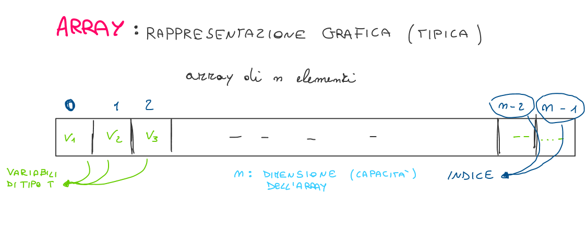
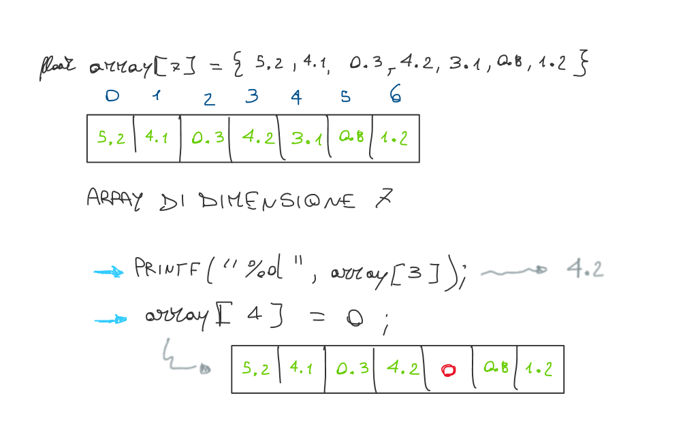
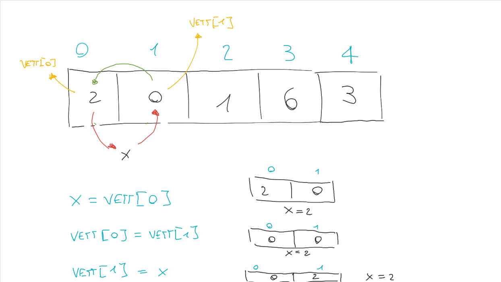
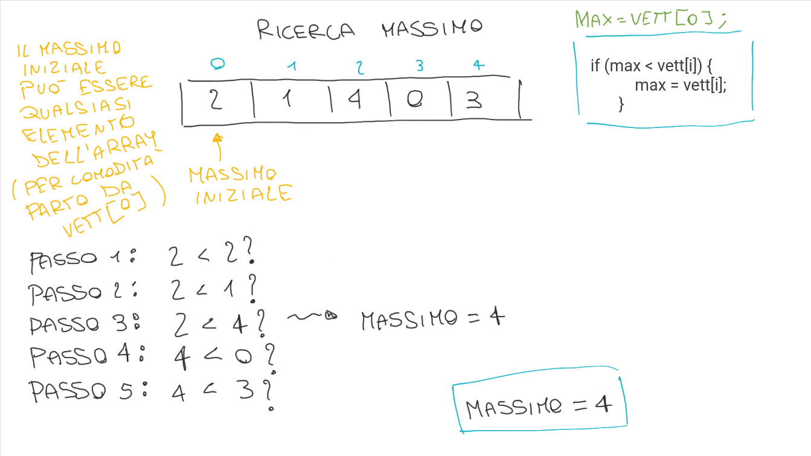

## 1. Descrizione

Un **array monodimensionale** (o vettore) è una sequenza di variabili dello stesso tipo che vengono situate consecutivamente nella memoria ed alle quali è possibile accedere usando uno stesso nome (identificatore) a cui viene aggiunto un indice. Pensiamo all'**array** come ad un insieme di cassetti numerati.

**Definizione**: **Sequenza** di $n$ elementi ($n ≥ 0$) tutti di tipo $t$ individuati singolarmente da un numero intero int fra 0 e $n-1$ (detto indice).



<Aside variant="info">
Se hai già studiato gli array in [C](/informatica/c/4_array-monodimensionali) o in [C++](/informatica/cpp/4_array-monodimensionali), l'idea è identica: cambiano la **sintassi della dichiarazione** e alcune **regole di sicurezza** che Java aggiunge. In questa lezione mettiamo in evidenza proprio queste differenze.
</Aside>

## 2. Dichiarazione

In Java un array è un **tipo reference** (come abbiamo visto nella lezione [Hello World](/informatica/java/1_hello-world)): la variabile non contiene gli elementi, ma un **riferimento** all'array che si trova in memoria. Per questo l'array va **creato con `new`**, come gli oggetti.

$$
t[\,] \ \ A = new \ t[n];
$$

dove:

- $A$ → identificatore (nome);
- $t$ → tipo degli elementi;
- $n$ → dimensione (numero di elementi), un valore intero.

```java
final int N = 10;

// dichiara un array di 10 interi
int[] A = new int[N];

// dichiara un array di 10 elementi float
float[] V = new float[10];

// la dimensione può essere decisa a run-time (es. letta da tastiera)
int m = 100;
int[] B = new int[m];

// array di interi con la dimensione definita implicitamente (5 elementi)
int[] C = {3, 5, 6, 2, 1};

// forma equivalente, utile quando l'array non viene creato nella dichiarazione
int[] D;
D = new int[] {3, 5, 6, 2, 1};

// array di stringhe
String[] nomi = {"Anna", "Luca", "Marco"};
```

<Aside variant="tip">
Java accetta anche la sintassi del C `int A[] = new int[10];`, ma per convenzione si preferisce `int[] A`: le parentesi quadre fanno parte del **tipo** ("array di int").
</Aside>

### 2.1 Valori di default

A differenza del C/C++, in Java un array appena creato **non contiene mai valori casuali**: ogni elemento viene inizializzato automaticamente.

| Tipo degli elementi | Valore iniziale |
| --- | --- |
| `int`, `long`, `short`, `byte` | `0` |
| `float`, `double` | `0.0` |
| `char` | `'\u0000'` (carattere nullo) |
| `boolean` | `false` |
| tipi reference (`String`, oggetti, …) | `null` |

```java
int[] voti = new int[5];
System.out.println(voti[3]); // Output: 0
```

## 3. Dimensione Array

In Java la dimensione di un array:

- può essere decisa a **run-time** (non serve una costante come in C);
- si legge con l'attributo **`length`** (senza parentesi!);
- una volta creato l'array **non può più cambiare**.

```java
int[] vett = {2, 0, 1, 6, 3};
System.out.println(vett.length); // Output: 5
```

<Aside variant="info">
Se serve una "lista" che cresce e si accorcia durante l'esecuzione, in Java si usa `ArrayList`, che vedremo nella lezione sulle [collezioni](/informatica/java/17_collezioni_liste).
</Aside>

## 4. Operazioni

### 4.1 Accesso elemento

```java
int[] vett = {2, 0, 1, 6, 3};
vett[4];  // -> mi riferisco al valore 3
```

### 4.2 Lettura elemento

```java
Scanner input = new Scanner(System.in);
int[] vett = new int[5];
vett[2] = input.nextInt(); // inserisco un valore nella posizione 3
```

### 4.3 Scrittura elemento

```java
int[] vett = {2, 0, 1, 6, 3};
System.out.println(vett[2]); // Output: 1
```



### 4.4 Uscire dai limiti dell'array

In C/C++ accedere a una posizione che non esiste produce un **comportamento indefinito**. Java invece **controlla sempre l'indice** e, se è fuori dall'intervallo $[0, length-1]$, interrompe il programma con un'eccezione:

```java
int[] vett = new int[5];
vett[5] = 10; // ERRORE a run-time
```

```bash
Exception in thread "main" java.lang.ArrayIndexOutOfBoundsException: Index 5 out of bounds for length 5
```

<Aside variant="warning">
L'ultimo indice valido è sempre `vett.length - 1`. Nei cicli usa `i < vett.length`, **non** `i <= vett.length`.
</Aside>

### 4.5 Cosa NON si fa (o non fa quello che ti aspetti)

- **Confronto con `==`**: compila, ma confronta i **riferimenti** (cioè "sono lo stesso array in memoria?"), non il contenuto.

    ```java
    int[] A = {1, 2, 3};
    int[] B = {1, 2, 3};

    System.out.println(A == B); // false! sono due array diversi
    ```

- **Assegnamento con `=`**: non copia gli elementi, ma fa puntare entrambe le variabili **allo stesso array**.

    ```java
    int[] A = {1, 2, 3};
    int[] B = A;   // B e A sono lo STESSO array

    B[0] = 99;
    System.out.println(A[0]); // Output: 99
    ```

- **Stampa diretta**: non stampa gli elementi, ma un codice interno.

    ```java
    int[] A = {1, 2, 3};
    System.out.println(A); // Output simile a: [I@1b6d3586
    ```

### 4.6 Soluzione a questi problemi

Come in C/C++, per eseguire correttamente operazioni di confronto, copia ed I/O si possono usare i **cicli**, lavorando elemento per elemento:

- Confronto e assegnamento:

    *esempio*: `A[i] == B[j]`

    *esempio*: `A[i] = 5`

- I/O su array:

    *esempio*: `A[3] = input.nextInt()`

    *esempio*: `System.out.println(A[i])`

In più Java mette a disposizione la classe di libreria **`java.util.Arrays`**, che fa queste operazioni al posto nostro:

```java
import java.util.Arrays;

int[] A = {3, 1, 2};
int[] B = {3, 1, 2};

System.out.println(Arrays.equals(A, B));   // true  -> confronta il contenuto
System.out.println(Arrays.toString(A));    // [3, 1, 2] -> stampa
int[] C = Arrays.copyOf(A, A.length);      // copia vera (nuovo array)
Arrays.sort(A);                            // ordina: A = [1, 2, 3]
Arrays.fill(B, 0);                         // B = [0, 0, 0]
```

## 5. Il ciclo for-each

Quando serve solo **leggere** tutti gli elementi, dall'inizio alla fine, Java offre il ciclo **for-each** (o *enhanced for*):

```java
int[] vett = {2, 0, 1, 6, 3};

for (int x : vett) {
    System.out.print(x + " ");
}

// Output: 2 0 1 6 3
```

Si legge: *"per ogni `x` contenuto in `vett`"*.

<Aside variant="warning">
Nel for-each `x` è una **copia** del valore: assegnare `x = 0` **non modifica** l'array. Per modificare gli elementi, o quando ti serve l'indice, usa il `for` classico.
</Aside>

## 6. Algoritmi principali

### 6.1 Stampa Array

```java
int[] vett = {2, 0, 1, 6, 3};

for (int i = 0; i < vett.length; i++) {
    System.out.print(vett[i] + " ");
}

// Output: 2 0 1 6 3
```

### 6.2 Leggi Array

```java
Scanner input = new Scanner(System.in);
int[] vett = new int[5];

for (int i = 0; i < vett.length; i++) {
    vett[i] = input.nextInt();
}
```

### 6.3 Ordinamento Array (Bubble Sort)


```java
int[] vett = {2, 0, 1, 6, 3};

for (int i = 0; i < vett.length; i++) {
    for (int j = 0; j < vett.length - 1; j++) {
        if (vett[j] > vett[j + 1]) {
            int temp = vett[j];
            vett[j] = vett[j + 1];
            vett[j + 1] = temp;
        }
    }
}
```

Ragionamento per "swappare" gli elementi di un array tra di loro:



<Aside variant="tip">
Nei programmi reali si usa direttamente `Arrays.sort(vett);`, ma scrivere il Bubble Sort a mano è un ottimo esercizio per capire come funzionano gli indici.
</Aside>

### 6.4 Ricerca Massimo/Minimo

```java
int[] vett = {2, 5, 1, 0, 3};

int max = vett[0];

for (int i = 0; i < vett.length; i++) {
    if (max < vett[i]) {
        max = vett[i];
    }
}

System.out.println(max);

// Output: 5
```



### 6.5 Somma e media

```java
int[] voti = {7, 8, 6, 9};

int somma = 0;
for (int v : voti) {
    somma += v;
}

double media = (double) somma / voti.length;
System.out.println("Media: " + media); // Output: Media: 7.5
```

<Aside variant="info">
Il `(double)` davanti a `somma` è un **casting esplicito**: senza, `30 / 4` sarebbe una divisione tra interi e darebbe `7`. Approfondiamo nella lezione [Casting implicito ed esplicito](/informatica/java/3_casting-implicito-esplicito).
</Aside>

## 7. Array e metodi

Un array si può passare a un metodo e un metodo può restituire un array. Poiché si passa il **riferimento**, le modifiche fatte dentro al metodo **si vedono anche fuori**.

```java
public class Main {

    static void raddoppia(int[] a) {
        for (int i = 0; i < a.length; i++) {
            a[i] = a[i] * 2;
        }
    }

    static int[] creaSequenza(int n) {
        int[] s = new int[n];
        for (int i = 0; i < n; i++) {
            s[i] = i + 1;
        }
        return s;
    }

    public static void main(String[] args) {
        int[] numeri = creaSequenza(4);   // [1, 2, 3, 4]
        raddoppia(numeri);
        System.out.println(java.util.Arrays.toString(numeri)); // [2, 4, 6, 8]
    }
}
```

<Aside variant="info">
Anche il parametro `String[] args` del `main` è un array: contiene gli argomenti passati al programma da riga di comando.
</Aside>

## 8. Riepilogo: Java vs C/C++

| | C / C++ | Java |
| --- | --- | --- |
| Dichiarazione | `int A[10];` | `int[] A = new int[10];` |
| Dimensione | costante (array statici) | anche decisa a run-time |
| Numero di elementi | va memorizzato a parte | `A.length` |
| Valori iniziali | casuali (se non inizializzati) | `0`, `false`, `null`, … |
| Indice fuori dai limiti | comportamento indefinito | `ArrayIndexOutOfBoundsException` |
| `A = B` | errore | copia il riferimento (stesso array) |
| `A == B` | errore / confronta indirizzi | confronta i riferimenti |
| Stampa | ciclo | ciclo oppure `Arrays.toString(A)` |

## 9. Quiz a risposta multipla

import Quiz from '../../../components/Quiz.jsx';

<Quiz client:load questions={[
  {
    question: "1) Come si dichiara correttamente un array di 10 interi in Java?",
    answers: {
      a: 'int A[10];',
      b: 'int[] A = new int[10];',
      c: 'int A = new int[10];',
      d: 'array int[10] A;'
    },
    correctAnswer: 'b',
    explanation: "In Java l'array è un tipo reference: va creato con new indicando la dimensione."
  },
  {
    question: "2) Dopo int[] v = new int[5]; quanto vale v[4]?",
    answers: { a: 'Un valore casuale', b: '4', c: '0', d: 'null' },
    correctAnswer: 'c',
    explanation: "Gli elementi di un array di int vengono inizializzati automaticamente a 0."
  },
  {
    question: "3) Come si ottiene il numero di elementi di un array v?",
    answers: { a: 'v.length()', b: 'v.size()', c: 'sizeof(v)', d: 'v.length' },
    correctAnswer: 'd',
    explanation: "length è un attributo, non un metodo: si scrive senza parentesi."
  },
  {
    question: "4) Cosa succede eseguendo v[5] = 1; se v ha 5 elementi?",
    answers: {
      a: 'Si scrive in una cella di memoria a caso',
      b: 'Viene lanciata ArrayIndexOutOfBoundsException',
      c: "L'array si allarga automaticamente",
      d: 'Non succede nulla'
    },
    correctAnswer: 'b',
    explanation: "Gli indici validi vanno da 0 a length-1: Java controlla sempre l'indice."
  },
  {
    question: "5) Dati int[] a = {1,2}; int[] b = a; b[0] = 9; quanto vale a[0]?",
    answers: { a: '1', b: '9', c: '0', d: 'Errore di compilazione' },
    correctAnswer: 'b',
    explanation: "b = a copia il riferimento: a e b sono lo stesso array."
  },
  {
    question: "6) Qual è il modo corretto per confrontare il CONTENUTO di due array a e b?",
    answers: { a: 'a == b', b: 'a.equals(b)', c: 'Arrays.equals(a, b)', d: 'a = b' },
    correctAnswer: 'c',
    explanation: "== (e anche a.equals(b)) confronta i riferimenti; Arrays.equals confronta elemento per elemento."
  },
  {
    question: "7) Nel ciclo for (int x : v) { x = 0; } cosa succede all'array v?",
    answers: {
      a: 'Tutti gli elementi diventano 0',
      b: 'Solo il primo elemento diventa 0',
      c: 'Non cambia',
      d: 'Errore di compilazione'
    },
    correctAnswer: 'c',
    explanation: "Nel for-each x è una copia del valore dell'elemento: modificarla non modifica l'array."
  }
]} />

<CodeQuiz title="Leggi il codice" questions={[
  {
    type: "output",
    question: "Cosa stampa questo codice?",
    lang: "java",
    code: `int[] v = {4, 7, 1, 9};
int s = 0;
for (int i = 1; i < v.length; i += 2) {
    s += v[i];
}
System.out.println(s);`,
    expected: "16",
    explanation: "Il ciclo visita solo gli indici dispari 1 e 3: 7 + 9 = 16."
  },
  {
    type: "bug",
    question: "Trova la riga con il bug",
    lang: "java",
    code: `int[] v = new int[5];
for (int i = 0; i <= v.length; i++) {
    v[i] = i * 2;
}`,
    bugLine: 2,
    fix: `int[] v = new int[5];
for (int i = 0; i < v.length; i++) {
    v[i] = i * 2;
}`,
    explanation: "Con i <= v.length l'ultimo giro usa l'indice 5, che non esiste: ArrayIndexOutOfBoundsException."
  }
]} />

## 10. Esercizi

[Esercizi con gli array in Java](https://codegrind.it/esercizi/java/array)

### 10.1 Esercizio - Array palindromo

Leggere un array di interi di 10 posizioni e verificare se è palindromo (ovvero se non cambia ad essere letto dalla prima cella all'ultima o viceversa).

> Esempio Output:
inserisci 10 valori: 3 5 7 9 1 1 9 7 5 3
l'array e' palindromo
<details>
<summary>💡 Mostra soluzione</summary>

```java
import java.util.Scanner;

public class Main {
    public static void main(String[] args) {
        Scanner input = new Scanner(System.in);
        int[] a = new int[10];

        System.out.print("inserisci 10 valori: ");
        for (int i = 0; i < a.length; i++) {
            a[i] = input.nextInt();
        }

        boolean palindromo = true;

        for (int i = 0; i < a.length / 2; i++) {
            if (a[i] != a[a.length - 1 - i]) {
                palindromo = false;
            }
        }

        if (palindromo) {
            System.out.println("l'array e' palindromo");
        } else {
            System.out.println("l'array NON e' palindromo");
        }

        input.close();
    }
}
```

</details>

### 10.2 Esercizio - Numeri unici

Leggere un array di 10 interi e stampare solo i numeri che appaiono nell'array una volta soltanto.

> Esempio Output:
inserisci 10 numeri interi: 1 3 5 3 2 0 5 2 3 4
1 0 4
<details>
<summary>💡 Mostra soluzione</summary>

```java
import java.util.Scanner;

public class Main {
    public static void main(String[] args) {
        Scanner input = new Scanner(System.in);
        int[] a = new int[10];

        // memorizzo l'array
        System.out.print("inserisci 10 numeri interi: ");
        for (int i = 0; i < a.length; i++) {
            a[i] = input.nextInt();
        }

        // per ogni numero dell'array conto quante volte compare
        for (int i = 0; i < a.length; i++) {
            int volte = 0;

            for (int j = 0; j < a.length; j++) {
                if (a[j] == a[i]) {
                    volte++;
                }
            }

            if (volte == 1) {
                System.out.print(a[i] + " ");
            }
        }

        input.close();
    }
}
```

</details>

### 10.3 Esercizio - Voti della classe

Chiedere all'utente quanti studenti ci sono in classe (`n`), creare un array di `n` voti (`double`), leggerli e stampare:

- la media;
- il voto più alto e quello più basso;
- quanti voti sono sufficienti (≥ 6).

> Esempio Output:
quanti studenti? 4
voto 1: 7
voto 2: 5.5
voto 3: 8
voto 4: 6
media: 6.625
massimo: 8.0 - minimo: 5.5
sufficienti: 3
<details>
<summary>💡 Mostra soluzione</summary>

```java
import java.util.Scanner;

public class Main {
    public static void main(String[] args) {
        Scanner input = new Scanner(System.in);

        System.out.print("quanti studenti? ");
        int n = input.nextInt();

        double[] voti = new double[n]; // dimensione decisa a run-time

        for (int i = 0; i < voti.length; i++) {
            System.out.print("voto " + (i + 1) + ": ");
            voti[i] = input.nextDouble();
        }

        double somma = 0;
        double max = voti[0];
        double min = voti[0];
        int sufficienti = 0;

        for (double v : voti) {
            somma += v;
            if (v > max) max = v;
            if (v < min) min = v;
            if (v >= 6) sufficienti++;
        }

        System.out.println("media: " + somma / voti.length);
        System.out.println("massimo: " + max + " - minimo: " + min);
        System.out.println("sufficienti: " + sufficienti);

        input.close();
    }
}
```

</details>

### 10.4 Esercizio - Inverti l'array

Scrivere un metodo `static void inverti(int[] a)` che inverte l'ordine degli elementi **dello stesso array** (senza crearne uno nuovo). Provarlo nel `main` stampando l'array prima e dopo con `Arrays.toString`.

> Esempio Output:
prima: [1, 2, 3, 4, 5]
dopo: [5, 4, 3, 2, 1]
<details>
<summary>💡 Mostra soluzione</summary>

```java
import java.util.Arrays;

public class Main {

    static void inverti(int[] a) {
        for (int i = 0; i < a.length / 2; i++) {
            int temp = a[i];
            a[i] = a[a.length - 1 - i];
            a[a.length - 1 - i] = temp;
        }
    }

    public static void main(String[] args) {
        int[] numeri = {1, 2, 3, 4, 5};

        System.out.println("prima: " + Arrays.toString(numeri));
        inverti(numeri); // l'array viene modificato perché passiamo il riferimento
        System.out.println("dopo: " + Arrays.toString(numeri));
    }
}
```

</details>
