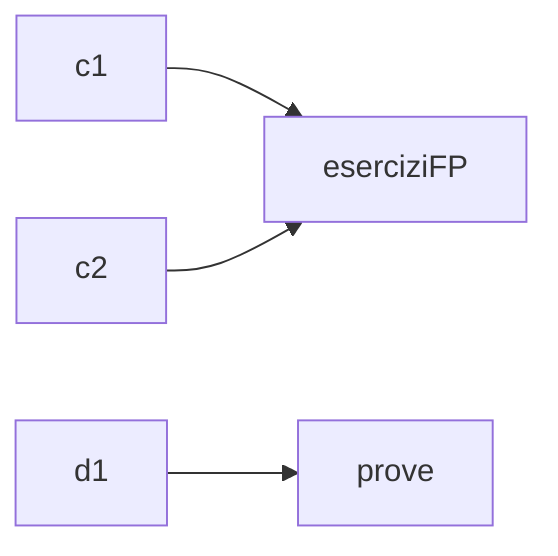
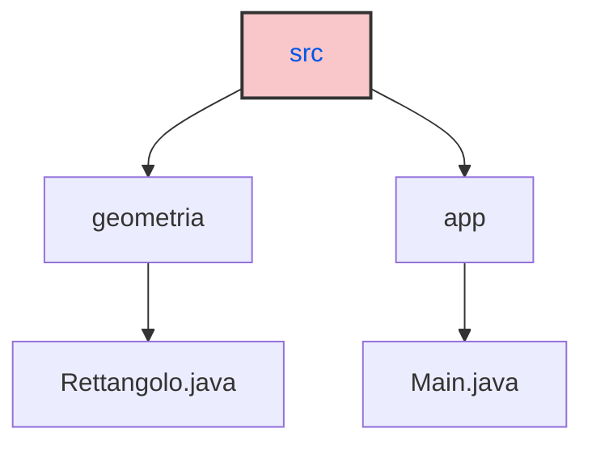

## 1. Introduzione

- Le classi correlate tra loro vengono raggruppate in **package**.
- Se la classe $c$ appartiene a un package $p$, è necessario inserire l'istruzione `package p;` all'inizio del file che contiene la classe $c$.



- Per convenzione, il nome di un package inizia con una lettera minuscola.

1. Tutti i file appartenenti allo stesso package devono essere collocati nella stessa cartella, il cui nome corrisponde a quello del package:

    ```mermaid
    flowchart TD
        src --> eserciziFP
        src --> prove
        eserciziFP --> c1.java
        eserciziFP --> c2.java
        prove --> d1.java

        style src fill:#f9c6c9,stroke:#333,stroke-width:2px,color:#0057e7
    ```

2. Se non è presente alcuna istruzione `package`, il file è considerato parte del **package di default** (generalmente la cartella `src`):

    ```mermaid
    flowchart TD
        src --> c1.java
        src --> c2.java
        src --> d1.java

        style src fill:#f9c6c9,stroke:#333,stroke-width:2px,color:#0057e7
    ```

   - **Nota**: È possibile includere una sola istruzione `package` in un file, che deve essere posta all'inizio del file, prima di qualsiasi altra istruzione.
   - È possibile riferirsi a una classe $c$ di un package $p$ da una classe in un altro package utilizzando:
       1. **Il nome completo della classe**:
           $$
           p.c
           $$

           Dove:

           - $p$ è il nome del package;
           - $c$ è il nome della classe.

           *Esempio*:

           ```java
           package prove;

           public class p1 {
               eserciziFP.c1 a;
               a = new eserciziFP.c1();
               a.f1();
               // Altre operazioni...
           }
           ```

       2. **L'istruzione `import`**, che permette di "importare" una o più classi di un package:

           *Esempio*:

           ```java
           package prove;

           import eserciziFP.c1; // Importa la classe c1

           public class d1 {
               c1 a;
               a = new c1();
               a.f1();
               // Altre operazioni...
           }
           ```

           - **Nota Bene**: `import eserciziFP.*;` importa tutte le classi del package.
           - **Nota Bene**: Classi con lo stesso nome ma in package diversi sono distinte, quindi è necessario usare il nome completo, ad esempio, *eserciziFP.c1* è diverso da *prove.c1*.

## 2. Package Standard

I package standard di Java sono sotto-package di `java`.

- **java.lang** (non richiede l'istruzione `import`)
  - Contiene classi come `Object`, `String`, `System`, `Integer`, `Character`, `Float`, ecc.
- **java.util**
  - Contiene classi come `Scanner`, `Vector`, `Set`, ecc.
- **java.io**
  - Contiene classi come `InputStream`, `PrintStream`, `IOException`, ecc.

## 3. Visibilità dei Nomi con i Package

La **visibilità** si applica sia ai **nomi delle classi** sia ai **nomi dei campi interni alle classi**.

### 3.1 Visibilità delle Classi vs Visibilità dei Campi

- **Visibilità delle classi:**
  - **public**: (esempio: `public class Razionale {…}`) La classe è visibile ovunque, anche al di fuori del package in cui è dichiarata.
  - **Default (senza `public`)**: (esempio: `class Razionale {…}`) La classe è visibile solo all'interno del package in cui è dichiarata (visibilità di package o predefinita).
- **Visibilità dei campi:**
  - **public**: I campi sono visibili ovunque.
  - **private**: I campi sono visibili solo all'interno della classe in cui sono dichiarati.
  - **Default (senza specifica)**: I campi sono visibili all'interno della classe in cui sono dichiarati e anche alle classi dello stesso package.

## 4. Quiz a risposta multipla

import Quiz from '../../../components/Quiz.jsx';

<Quiz client:load questions={[
  {
    question: "1) A cosa serve un package in Java?",
    answers: {
      a: 'A compilare più velocemente il programma',
      b: 'A raggruppare classi correlate tra loro',
      c: 'A creare oggetti',
      d: 'A gestire le eccezioni'
    },
    correctAnswer: 'b',
    explanation: "Un package raggruppa classi correlate, come una cartella raggruppa file."
  },
  {
    question: "2) Dove deve essere scritta l'istruzione package?",
    answers: {
      a: 'In qualsiasi punto del file',
      b: 'Dopo gli import',
      c: "All'inizio del file, prima di qualsiasi altra istruzione",
      d: 'Dentro al metodo main'
    },
    correctAnswer: 'c',
    explanation: "Ogni file può avere una sola istruzione package, e va messa per prima."
  },
  {
    question: "3) Quale package NON richiede l'istruzione import?",
    answers: { a: 'java.util', b: 'java.io', c: 'java.lang', d: 'java.net' },
    correctAnswer: 'c',
    explanation: "java.lang (String, System, Integer, ...) è importato automaticamente."
  },
  {
    question: "4) Cosa fa l'istruzione import java.util.*;?",
    answers: {
      a: 'Importa solo la classe Scanner',
      b: 'Importa tutte le classi del package java.util',
      c: 'Importa tutti i package di Java',
      d: 'Crea un nuovo package chiamato util'
    },
    correctAnswer: 'b',
    explanation: "L'asterisco indica tutte le classi di quel package (non dei sotto-package)."
  },
  {
    question: "5) Una classe dichiarata senza public (es. class Razionale) è visibile:",
    answers: {
      a: 'Ovunque',
      b: 'Solo dentro il suo package',
      c: 'Solo dentro il metodo main',
      d: 'Da nessuna parte'
    },
    correctAnswer: 'b',
    explanation: "Senza modificatore la visibilità è quella di package (default)."
  },
  {
    question: "6) Un campo private è visibile:",
    answers: {
      a: 'Solo nella classe in cui è dichiarato',
      b: 'In tutte le classi dello stesso package',
      c: 'Ovunque',
      d: 'Solo nelle sottoclassi'
    },
    correctAnswer: 'a',
    explanation: "private limita l'accesso alla sola classe che dichiara il campo."
  },
  {
    question: "7) Esistono prove.Studente e scuola.Studente. Cosa si può dire?",
    answers: {
      a: 'Errore: due classi non possono avere lo stesso nome',
      b: 'Sono la stessa classe',
      c: 'Sono due classi distinte; per usarle insieme serve il nome completo',
      d: 'Java usa sempre quella importata per ultima'
    },
    correctAnswer: 'c',
    explanation: "Il nome completo di una classe include il package: prove.Studente ≠ scuola.Studente."
  }
]} />

## 5. Esercizi

### 5.1 Esercizio - Il mio primo package

Creare un progetto con questa struttura:



- la classe `Rettangolo` (package `geometria`) ha un metodo `public static double area(double base, double altezza)`;
- la classe `Main` (package `app`) importa `Rettangolo` e stampa l'area di un rettangolo 3 × 4.

<details>
<summary>💡 Mostra soluzione</summary>

```java
// file: src/geometria/Rettangolo.java
package geometria;

public class Rettangolo {
    public static double area(double base, double altezza) {
        return base * altezza;
    }
}
```

```java
// file: src/app/Main.java
package app;

import geometria.Rettangolo;

public class Main {
    public static void main(String[] args) {
        System.out.println("Area: " + Rettangolo.area(3, 4)); // Area: 12.0
    }
}
```

</details>

### 5.2 Esercizio - Nome completo vs import

Riscrivere il `Main` dell'esercizio precedente **senza** l'istruzione `import`, usando il nome completo della classe.

<details>
<summary>💡 Mostra soluzione</summary>

```java
package app;

public class Main {
    public static void main(String[] args) {
        System.out.println("Area: " + geometria.Rettangolo.area(3, 4));
    }
}
```

</details>

### 5.3 Esercizio - Trova l'errore di visibilità

Nel package `banca` c'è questa classe:

```java
package banca;

class Conto {
    private double saldo;
    double getSaldo() { return saldo; }
}
```

Dal package `app` si prova a scrivere:

```java
package app;

import banca.Conto;

public class Main {
    public static void main(String[] args) {
        Conto c = new Conto();
        System.out.println(c.getSaldo());
    }
}
```

Perché il codice non compila? Correggere la classe `Conto` in modo che `Main` funzioni, **senza** rendere pubblico il campo `saldo`.

<details>
<summary>💡 Mostra soluzione</summary>

Il codice non compila per due motivi:

1. la classe `Conto` non è `public`, quindi è visibile solo dentro il package `banca`;
2. il metodo `getSaldo()` non ha modificatore (visibilità di package), quindi non è accessibile da `app`.

```java
package banca;

public class Conto {
    private double saldo;            // resta privato

    public double getSaldo() {       // ora accessibile da altri package
        return saldo;
    }
}
```

</details>

### 5.4 Esercizio - Package standard

Scrivere un programma che, **senza** usare `import`, legge un numero con `java.util.Scanner` e ne stampa la radice quadrata con `Math.sqrt`. Perché `Math` non richiede né `import` né il nome completo?

<details>
<summary>💡 Mostra soluzione</summary>

```java
public class Main {
    public static void main(String[] args) {
        java.util.Scanner input = new java.util.Scanner(System.in);

        System.out.print("inserisci un numero: ");
        double n = input.nextDouble();

        System.out.println("radice: " + Math.sqrt(n));

        input.close();
    }
}
```

`Math` (come `System` e `String`) fa parte di `java.lang`, che Java importa automaticamente.

</details>
